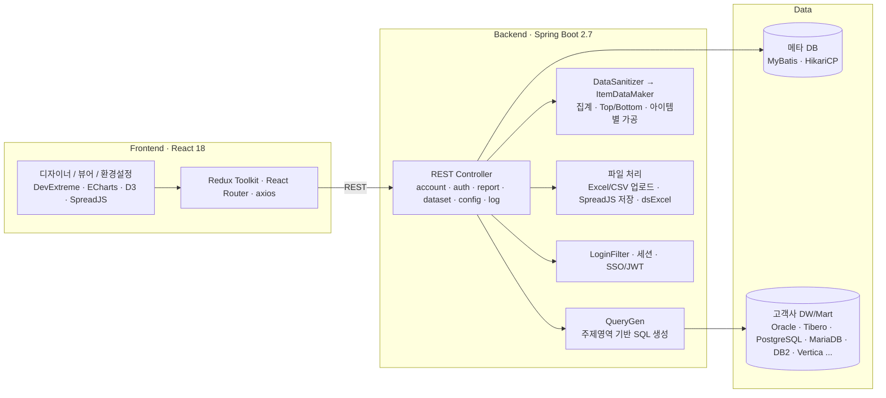
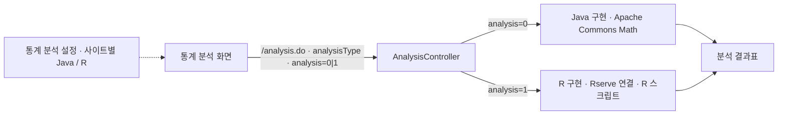
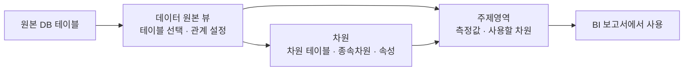
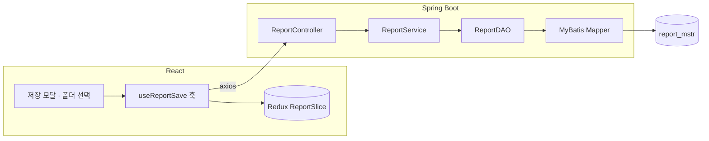
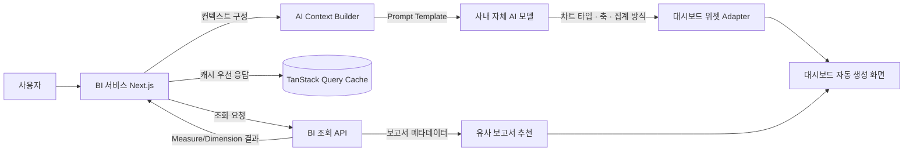

# 🏢 Career

㈜위세아이텍 AX Development Team에서 2020년 7월부터 BI(Business Intelligence) 플랫폼 **WISEOLAP**과 데이터 설계 플랫폼을 개발하고 있습니다. JSP 버전부터 React·Spring Boot 전환 버전, 공공기관 공통 버전까지 제품의 세대 전체를 거치며, 기능 하나를 **DB 쿼리부터 API, 화면까지 끝까지 맡는 방식**으로 일해 왔습니다.

> 이 문서의 내용은 회사 저장소 8곳의 본인 커밋(약 1,225건)과 JSP 버전 배포본 소스에 남긴 변경 표시(약 950곳)를 근거로 정리했습니다. 고객사 내부 시스템 명칭과 데이터는 일반화했습니다.

🧭 [portfolio.md](./portfolio.md) · 성능·안정성 사례: [performance.md](./performance.md)

---

## 📋 한눈에 보기

| #   | 프로젝트                | 기간                | 역할              | 핵심                                               | 본인 커밋         |
| --- | ------------------- | ----------------- | --------------- | ------------------------------------------------ | ------------- |
| 1   | WISEOLAP JSP 버전 고도화    | 2020.07 ~ 2022.04 | Full-Stack      | 카카오 지도 위젯 신규 개발, 통계 분석 Java·R 이중 구현              | 변경 표시 약 950곳  |
| 2   | BI 데이터 설계 플랫폼       | 2022.10 ~ 2023.07 | Full-Stack      | 테이블 관계 설정 화면, 변경분 저장 API                         | 173건          |
| 3   | WISEOLAP React·Spring Boot 전환    | 2023.08 ~ 2024.01 | Full-Stack      | React·Spring Boot 신규 구축, 보고서 저장·Top/Bottom 서버 처리 | 홈앤쇼핑 저장소에 포함  |
| 4   | 전사 관리 지표 플랫폼 (홈앤쇼핑) | 2024.01 ~ 2025.05 | PL · Full-Stack | 사용자·권한·보고서 관리 API, 쿼리 로그, 엑셀 양식 보고서 성능           | 570건 (전환 버전 포함) |
| 5   | 고객사 BI 구축           | 2022.09 ~ 현재      | Full-Stack      | SSO·JWT, 보안 점검 조치, 3D·시계열 분석, 외부 플랫폼 연동          | 482건          |
| 6   | AI 기반 분석 자동화        | 2025.08 ~ 현재      | Full-Stack      | AI 차트·대시보드 자동 생성                                 | —             |

---

## 🧱 제품과 아키텍처

### 제품 세대

| 세대 | 구조 | 참여 |
| --- | --- | --- |
| **JSP 버전** | JSP · jQuery · DevExtreme / Spring MVC 4.2 · MyBatis 3.2 | 2020.07 ~ 2022.04 — 카카오 지도, 통계 분석, 고객사 대응 |
| **React·Spring Boot 버전** | React 18 · Redux Toolkit / Spring Boot 2.7 · MyBatis, Maven으로 단일 WAR 빌드 | 2023.08 ~ — 초기 구축부터 참여, 홈앤쇼핑·SH공사 구축 |
| **공공기관 공통 버전** | React·Spring Boot 버전 구조 + 공공기관 공통화 (DBMS별 Mapper, 기관별 SSO) | 2025.02 ~ — 3D·시계열 분석, 기관 연동 |
| 고객사 저장소 | 공통 소스를 고객사별 저장소로 분리해 커스터마이징하고, 고객사에서 고친 오류는 공공기관 공통 버전에 다시 반영 | 천주교, SH공사, 스포츠토토, 한국자활, 한국콘텐츠진흥원 |

### React·Spring Boot 버전 구조

| 계층 | 기술 |
| --- | --- |
| Frontend | React 18, Redux Toolkit, React Router 6, DevExtreme, ECharts(+GL), D3.js, SpreadJS 17/18, styled-components |
| Backend | Java, Spring Boot 2.7, MyBatis, HikariCP, Apache POI, GrapeCity Documents for Excel(dsExcel), Log4j2 |
| Database | Oracle, Tibero, PostgreSQL, MariaDB, DB2, Vertica, MSSQL (DBMS별 쿼리 설정·Mapper 분리) |
| Build / Deploy | Maven(프론트엔드 빌드 포함 단일 WAR), Tomcat, GitHub Actions |

---

## 1. WISEOLAP JSP 버전 고도화 — 카카오 지도 위젯 · 통계 분석 엔진

> 입사 직후 JSP 기반 구버전에서 **카카오 지도 위젯을 처음부터 만들고**, 통계 분석을 **Java와 R 두 방식으로 계산하는 서버 구조**를 맡았습니다.

| 기간 | 역할 | 기술 스택 |
| --- | --- | --- |
| 2020.07 ~ 2022.04 | Full-Stack | jQuery, DevExtreme, Kakao Maps API, JSP · Spring MVC 4.2, MyBatis 3.2, R(Rserve), Apache Commons Math |

**핵심 기여**
- 카카오 지도 위젯 신규 개발 — 위젯 코드 9,300줄 중 약 440곳이 본인 변경 (문화정보원)
- 통계 분석 12종의 R 구현과 사이트별 Java/R 전환 설정 (회귀·분산·상관 분석, Z·t·카이제곱·F 검정 등)
- 산림청·한국소방·자산관리공사 등 고객사 요구와 운영 이슈 대응

### 해결한 문제

**① 제품에 없던 지도 위젯** — 문화정보원, 2020.08 ~ 11

문화 데이터를 지역별로 보여줘야 했지만 제품에는 주소·좌표 기반 지도가 없었습니다.

- 데이터가 주소인지 위도·경도인지에 따라 마커 위치를 다르게 계산
- 마커가 많으면 **마커 클러스터러**로 묶고, 값 크기에 따라 표시할 마커를 거르는 범위 슬라이더 제공
- 시도·시군구 **폴리곤 코로플레스**와 색상·선·라벨 서식 편집 팝업, 마우스 오버 강조
- 마커 클릭 시 같은 보고서의 다른 아이템을 거르는 **마스터 필터** 연동
- 마커 이미지 범례·툴팁·즐겨찾기를 보고서에 저장, 한반도 줌 레벨에서만 타일셋 표시
- 다시 그릴 때 이전 마커·폴리곤·툴팁을 `setMap(null)`로 해제하고, 툴팁은 한 번에 하나만 열리도록 정리 ([상세](./performance.md))

**② 통계 분석을 R과 Java 양쪽으로** — 2021.01 ~ 03

분석 결과를 R과 같은 형식으로 보고 싶다는 요구가 있었지만, 모든 고객사 서버에 R을 설치할 수는 없었습니다.

- 같은 `/analysis.do` 엔드포인트에서 요청 파라미터(`analysisType`, `analysis=0|1`)로 **Java 구현(Commons Math)과 R 구현(Rserve)** 이 나뉘는 구조에서, 회귀·분산·상관 분석의 R 버전을 구현
- 조회 데이터를 숫자·문자 벡터로 Rserve에 넘기고 R 스크립트를 실행해, R 출력 형식 그대로의 결과표를 화면에 전달
- Z·카이제곱·F 검정과 기술통계를 추가하고 시계열 분석을 R로 전환
- 사이트별로 계산 방식을 고르는 **통계 분석 설정**을 추가해 R 서버가 없는 고객사도 같은 기능 사용

**③ 고객사 구축·운영 지원** — 2021 ~ 2022
- 산림청: 코로플레스 드릴다운·드릴업 시 지역명이 아니라 **행정구역 코드**로 하위 지역을 찾도록 고정, 드릴다운 시 마스터 필터 연동, 뷰어 무한 로딩 수정
- 한국소방·자산관리공사: 사용하지 않는 기능 숨김, UI 커스터마이징
- 보고서 레이아웃 설정(축·범례·그리드·타이틀), 데이터 원본 연결 테스트, 직접 접근 시 스프레드시트 디자이너 이동

### 🧩 설계 포인트

| 패턴 | 적용 위치 | 선택한 이유 |
| --- | --- | --- |
| **Strategy** | 통계 분석 Java / R 구현 | 같은 분석 요청을 계산 방식만 바꿔 처리해, R 서버 유무와 관계없이 같은 화면·API를 쓰도록 하기 위해 |
| **Observer** | 지도 마커·폴리곤 클릭 → 마스터 필터 | 지도에서 일어난 선택을 이벤트로 알리고, 다른 아이템이 각자 필터를 적용하도록 하기 위해 |

### 성과
- 제품에 없던 주소·좌표 기반 지도 시각화를 추가해 문화정보원 구축에 사용
- R 서버 유무와 관계없이 12종 통계 분석을 제공하는 구조 확보
- 이때의 지도·통계 경험이 이후 React 버전의 코로플레스·시계열 분석 개발로 이어짐

---

## 2. BI 데이터 설계 플랫폼 개발

> SQL을 모르는 사용자가 **원본 테이블 → 데이터 원본 뷰 → 차원 → 주제영역** 순서로 분석용 데이터 모델을 화면에서 설계하는 서비스입니다. 핵심 화면인 관계 설정과 저장 흐름을 화면부터 쿼리까지 맡았습니다.

| 기간 | 역할 | 기술 스택 |
| --- | --- | --- |
| 2022.10 ~ 2023.07 (이후 2024.04까지 유지보수) | Full-Stack · 본인 커밋 173건 | React 17, Redux Toolkit, DevExtreme(DataGrid·TreeList) · Spring Boot, MyBatis, Oracle · Jira |

**핵심 기여**
- 데이터 원본 뷰 **관계 설정 화면** (자동 매핑, 1:N·N:1, 복합키)
- 데이터 원본 뷰·차원·주제영역 **저장 API** — 서비스·컨트롤러 수천 줄 직접 수정
- DBMS별 메타 조회 쿼리, Oracle 원본 뷰 생성 쿼리 튜닝

### 해결한 문제

**① 비개발자에게 어려운 테이블 관계 설정**
- 테이블 목록에서 컬럼을 골라 관계를 만들고, 관계 목록에 테이블·컬럼명·데이터 유형·길이를 함께 표시
- 자동 매핑 옵션, 1:N·N:1 설정 시 확인 알림, 복합키 제약명 처리, 관계 초기화 버튼
- 선택한 테이블 기준으로 관계 목록을 거르고, 컬럼 삭제 시 연결된 관계도 함께 삭제

**② 여러 화면이 함께 고치는 설계 데이터의 저장**
- **[Frontend]** 편집한 행마다 수정 상태(`modifyTag`)를 표시하고 Redux slice로 설계 상태를 관리해, 저장 시 변경분만 전송
- **[Backend]** 수정 상태에 따라 추가·수정·삭제를 나눠 반영하고, 차원 추가 시 측정값과 연결된 차원 테이블만 조회
- 저장 후 재조회 시 속성 패널·트리를 초기화해 이전 상태가 남지 않도록 처리

**③ DBMS마다 다른 메타 정보**
- 원본 DB 종류별 테이블·컬럼 메타 조회 쿼리를 나눠 관리하고, Oracle 원본 뷰 생성 쿼리 튜닝(WID-225, WID-172)
- 원본 뷰 생성 시 timestamp 컬럼 제외, Oracle SERVICE NAME 접속 방식 분기 추가

### 🧩 설계 포인트

| 패턴 | 적용 위치 | 선택한 이유 |
| --- | --- | --- |
| **Composite** | 주제영역 → 차원 → 테이블 → 컬럼 트리 | 계층마다 노드 종류가 달라도 선택·펼치기·검색을 하나의 트리로 처리하기 위해 |
| **변경 추적 (Unit of Work)** | `modifyTag` 기반 저장 | 여러 번 편집한 결과를 모아 변경분만 한 번에 반영하기 위해 |
| **Custom Hooks** | DataGrid·TreeList 공통 속성 훅 | 화면마다 다르게 설정되던 그리드 동작을 한곳에서 관리하기 위해 |

### 성과
- SQL 지식 없이 테이블 관계와 차원·주제영역을 설계할 수 있는 화면 구축
- 관계 설정과 저장 흐름을 화면부터 쿼리까지 개발해 BI 보고서의 데이터 모델 기반 제공

---

## 3. WISEOLAP React·Spring Boot 전환 — JSP에서 SPA로 재구축

> JSP 기반 제품을 **Spring Boot REST API + React SPA**로 새로 만든 전환 버전에 초기부터 참여해, 뷰어·데이터 그리드·보고서 저장·Top/Bottom 서버 처리를 화면과 API 양쪽에서 개발했습니다. 이 구조가 이후 홈앤쇼핑·공공기관 공통 버전·고객사 버전의 기반이 됐습니다.

| 기간 | 역할 | 기술 스택 |
| --- | --- | --- |
| 2023.08 ~ 2024.01 | Full-Stack | React 18, Redux Toolkit, React Router, DevExtreme, styled-components, ESLint(Google) · Spring Boot, MyBatis, JUnit · Maven |

**핵심 기여**
- 보고서 저장 / 다른 이름으로 저장 / 삭제를 모달·훅·Redux부터 API·Mapper까지 신규 개발
- 서버 데이터 정제 파이프라인에 Top/Bottom 단계 추가
- 뷰어 화면, 공통 UI(탭·툴바·필터 바), 데이터 그리드 아이템

### 해결한 문제

**① 보고서 저장 흐름을 처음부터 설계**
- **[Frontend]** 저장 모달·폴더 선택 컴포넌트와 저장 로직을 묶은 `useReportSave` 훅을 만들고, Redux slice 상태 이름을 DB 컬럼(`report_mstr`)과 맞춰 변환을 단순화
- **[Backend]** 보고서 저장 API(Controller → Service → DAO → Mapper)를 개발하고, 보고서 정의가 담긴 CLOB 컬럼 upsert 쿼리 수정
- 저장·다른 이름으로 저장·삭제에 유효성 검사와 알림, 불러온 보고서 재저장 시 이전 보고서 정리

**② 화면에서 처리하던 Top/Bottom**
- **[Backend]** 서버 정제 파이프라인(`DataSanitizer`)에 Top/Bottom 단계를 추가하고 `TopBottomInfo`를 구현해 차트·피벗 가공에 연결
- **[Frontend]** 아이템별 Top/Bottom 설정 모달·폼
- 이후 동료가 차원 계층별 그룹 처리를 더한 구조로 확장해 홈앤쇼핑 운영에 사용 ([상세](./performance.md))

**③ 아이템마다 반복되는 생성·가공 코드**
- 아이템 생성(`makeItem`)과 데이터 준비(`makeMart`)를 모듈로 분리하고, 메타 정보와 조회 결과 처리를 나눠 비정형 보고서와 대시보드가 같은 흐름을 쓰도록 정리
- JSDoc으로 함수 계약 문서화, 중복 함수 제거, `getElementById` 직접 접근을 `ref`로 교체
- 데이터 그리드 막대 표시에서 셀마다 하던 열 최댓값 계산을 열당 1회로 축소 ([상세](./performance.md))

### 🧩 설계 포인트

| 패턴 | 적용 위치 | 선택한 이유 |
| --- | --- | --- |
| **Atomic Design** | `components/common/atomic` 공통 컴포넌트 | 원자 단위부터 조합 단위까지 계층을 정해 공통 컴포넌트의 위치와 조합 기준을 만들기 위해 |
| **Custom Hooks** | `useReportSave` 등 | 저장 흐름(검증 → API → 상태 갱신)을 화면에서 떼어내 재사용하기 위해 |
| **Pipeline** | 서버 `DataSanitizer` → Top/Bottom 단계 | 정렬·집계·Top/Bottom 같은 후처리를 단계로 이어 붙여, 새 후처리를 기존 단계 수정 없이 추가하기 위해 |
| **Layered Architecture** | Controller → Service → DAO → Mapper | 새 API가 많은 초기 단계에서 계층별 책임을 고정하기 위해 |

### 성과
- 전환 버전의 뷰어·데이터 그리드·보고서 저장을 화면부터 API까지 구축해 이후 제품·고객사 버전의 공통 기반으로 사용
- 화면에서 처리하던 Top/Bottom을 서버 파이프라인으로 옮겨 이후 확장의 기반 마련

---

## 4. 전사 관리 지표 플랫폼 (홈앤쇼핑)

> React·Spring Boot 버전 기반으로 홈앤쇼핑 전사 관리 지표 시스템을 구축하며 처음 프로젝트 리더를 맡았습니다. **사용자·권한·보고서 관리와 쿼리 실행 로그를 API부터 화면까지** 만들고, 엑셀 양식 보고서 성능을 개선했습니다.

| 기간 | 역할 | 기술 스택 |
| --- | --- | --- |
| 2024.01 ~ 2025.05 (2026.04 보안 점검 대응) | 프로젝트 리더 · Full-Stack | React, Redux Toolkit, DevExtreme, SpreadJS · Spring Boot, MyBatis, Oracle, dsExcel · GitHub Actions, Jira |

**핵심 기여**
- 사용자/그룹/권한·데이터 원본·보고서/폴더 관리 **API와 환경설정 화면** 신규 개발
- 쿼리 실행 로그 개선과 **보고서 쿼리 검색** 기능
- 엑셀 양식 보고서(SpreadJS) 저장·불러오기·다운로드 개선, 공용 보고서 목록 조회 개선

### 해결한 문제

**① 프로젝트 운영 체계**
- 기능별 예상 소요 시간과 리스크를 산정해 팀 일정을 수립하고, 주요 리스크를 사전에 식별해 대응

**② 환경설정 기능의 부재 — 사용자·그룹·권한 관리**

고객사 운영 정책(그룹 단위 권한, 비밀번호 만료, 엑셀 업로드 권한 분리 등)을 담을 환경설정이 없었습니다.

- 사용자/그룹 생성·수정·삭제, 비밀번호 변경·만료일 API와 화면 (Controller → Service → DAO → MyBatis Mapper)
- 그룹·사용자별 보고서/데이터 원본/폴더 권한 저장·불러오기, 그룹·사용자별 **기능(프로그램) 권한** API 추가로 엑셀 업로드·리소스맵 등을 기능 단위로 제한
- 하드코딩되어 있던 `admin` 판별을 로그인 세션 기반으로 바꾸고, 보고서 저장·폴더 선택에 로그인 사용자 권한 적용
- 데이터 원본 추가(Oracle 접속 유형 포함) 저장·삭제

**③ 추적할 수 없던 쿼리 — 실행 로그와 쿼리 검색**
- 쿼리 실행 로그에 보고서명·그룹 ID가 남도록 적재 로직을 고치고, 쿼리 직접입력 보고서도 보고서명이 기록되도록 수정
- 환경설정에 수행 쿼리 정보 화면(다중 정렬·필터 그리드)과 쿼리 실행 결과 보기 추가
- 쿼리 내용·주제영역 이름으로 보고서를 찾는 **보고서 쿼리 검색**을 백엔드부터 화면까지 개발
- 원천 시스템과 OLAP 데이터 차이를 미리 알리는 안내 테이블·알림, 사용자별 최대 조회 기간 저장과 서버 검증

**④ 엑셀 양식 보고서(SpreadJS)의 느린 저장·불러오기**
- **[Frontend]** 셀 단위 바인딩을 테이블 단위(tableBinding)로, 파일 열기를 지연 로드로 바꾸고, 틀 고정 해제 시 내부 스크롤로 보이는 영역부터 그리도록 조정
- **[Backend]** 보고서 파일 저장·불러오기·삭제 로직 정리, 엑셀 생성을 서버 dsExcel 처리로 전환, 데이터 집합 쿼리 조회 비동기 처리
- SpreadJS 17.1.3 업그레이드 ([상세](./performance.md))

**⑤ 보고서 관리의 복잡도**
- 보고서와 폴더를 같은 트리 노드로 다루도록 바꾸고(TreeView → TreeList), 개인·공용 보고서/폴더 Drag & Drop과 이동 가능 여부 검증을 한곳으로 모음
- 등록·수정 일자/사용자를 서버에서 함께 저장, 즐겨찾기·보고서 검색·피벗그리드 틀 고정·보고서 조회 여부 설정
- 공용 보고서 목록 조회의 보고서×폴더 이중 반복을 `Set` 조회와 사용자명 캐시로 개선 ([상세](./performance.md))
- 수행 쿼리 그리드를 분리해 행 클릭 시 화면 전체 리렌더링 제거 ([상세](./performance.md))

**⑥ 사내 보안 환경**
- DRM이 적용된 엑셀 업로드를 위해 서버에서 DRM 복호화 API 호출
- 세션 유지 정책(8시간) 반영, SSO 로그인 세션 로그, 로그아웃 후 다른 계정 로그인 시 세션 오류 수정
- 2026.04 보안 점검: 마이페이지 처리의 검증 누락 조치, SSO 로그인 로그 추가

### 🧩 설계 포인트

| 패턴 | 적용 위치 | 선택한 이유 |
| --- | --- | --- |
| **Layered Architecture** | Controller → Service → DAO → MyBatis Mapper | 권한·로그·보고서 관리처럼 새 API가 많은 상황에서 계층별 책임을 고정하기 위해 |
| **Composite** | 보고서·폴더 트리 Drag & Drop | 폴더와 보고서를 같은 노드로 다뤄 이동·삭제·검증 로직을 한 번만 작성하기 위해 |

### 성과
- 사용자·그룹·권한·보고서 관리와 쿼리 실행 로그를 갖춘 환경설정을 API부터 화면까지 완성
- 엑셀 양식 보고서의 저장·불러오기·다운로드 속도 개선, 서식 유실·파일 중복 해소
- 쿼리 실행 이력이 남아 데이터 불일치·성능 문의에 근거를 갖고 대응

---

## 5. 고객사 BI 구축 및 커스터마이징

> 산업군이 다른 고객사마다 **인증 방식, DBMS, 보안 기준, 분석 요구**가 달랐습니다. 고객사 저장소를 직접 만들어 구축하고, 화면뿐 아니라 인증 연동·쿼리 생성·커넥션·보안처럼 서버에서 풀어야 하는 요구도 맡았습니다.

| 고객사 | 기간 | 본인 커밋 | 핵심 |
| --- | --- | --- | --- |
| 천주교 | 2022.09 ~ 2023.02 | 41 / 전체 50 | 외부 데이터 플랫폼(티맥스 HyperData) 사용자·데이터 연동 |
| SH공사 | 2023.07 ~ 2023.11 | 25 | Vertica 지원 |
| 스포츠토토 | 2025.06 ~ 2026.04 | 72 / 전체 116 | SSO·JWT, 비상 로그인, 보안 점검 조치 |
| 공공기관 공통 버전 | 2025.02 ~ 현재 | 130 | 3D 차트·시계열 분석, 포털·기관 SSO 연동 |
| 한국자활 · 경찰청 | 2026.03 ~ 현재 | 194 / 전체 210 | 쿼리 생성·커넥션 풀, 분석 기능, 행정구역 개편 |
| 한국콘텐츠진흥원 | 2026.08 ~ 2026.10 | 20 (한국자활에서 분기) | PDF 내보내기, 세계 지도 |

그 외 JSP 버전 시기의 문화정보원·산림청·한국소방·자산관리공사는 1. WISEOLAP JSP 버전 고도화에 정리했습니다.

### 천주교 — 외부 데이터 플랫폼 연동 (2022.09 ~ 2023.02)

티맥스 HyperData 플랫폼 안에서 BI를 쓰도록 연동한 구축으로, 저장소를 만들고 커밋의 대부분을 직접 작성했습니다.

- **[Backend] 사용자 식별 연동**: 플랫폼이 넘겨주는 암호화된 사용자 ID를 HyperData 복호화 API로 풀어 BI 로그인 사용자로 매핑
- **[Backend] 데이터 원본 자동 등록**: 플랫폼의 사용자–프로젝트 매칭 뷰(PostgreSQL)를 조회해, 로그인 사용자가 속한 프로젝트의 데이터 원본을 자동으로 추가·갱신하고 그 사용자의 데이터 집합만 표시
- **[Backend]** 세션 만료 안내 페이지, 로그인 세션 오류 수정, HTTPS 환경 혼합 콘텐츠 처리
- **[Frontend]** 플랫폼에 맞춘 로고·메뉴 정리, 뷰어 직접 접근 시 불필요한 기능 숨김, 보고서 속성에 보고서 URL 추가

### SH공사 — Vertica 지원 (2023.07 ~ 2023.11)

- **[Backend]** DBMS별 메타 조회 쿼리에 Vertica 분기를 추가해 스키마 단위로 테이블·컬럼 정보를 읽도록 수정(WID-260), Vertica에서 단일 테이블 계산된 컬럼이 추가되지 않던 오류 수정(WID-261)
- **[Frontend]** 단일 테이블 매개변수 편집 후 필터 미적용, 트리맵 CSV 다운로드 시 쉼표 이스케이프 등 현장 방문 패치

### 스포츠토토 — SSO 연동과 보안 점검 대응 (2025.06 ~ 2026.04)

고객사 통합 인증(SSO)으로 로그인해야 했고, SSO 장애 시에도 업무가 멈추지 않아야 했습니다. 외부 웹 취약점 점검에서는 Path Traversal·SQL Injection이 지적됐습니다. 저장소 생성부터 구축·운영까지 담당했습니다.

- **[Backend] SSO + JWT 연동**: SSO 토큰을 쿠키로 받아 사용자를 확인한 뒤, 제품 내부 인증은 JWT로 발급해 기존 인가 로직을 그대로 사용
- **[Backend] 비상 로그인 검증 API**: SSO 장애 시 발급되는 비상 토큰은 고객사 비상 인증 서버에 사용자·IP를 조회해 정상 세션일 때만 로그인 허용
- **[Backend] 환경 분리**: 로컬/운영 profile별 SSO 엔진 주소·클라이언트 IP 해석 분리, 토큰 없음·만료 시 리다이렉트
- **[Full-Stack] 요청 본문 암호화로 SQL Injection 차단**: 요청 본문을 axios 인터셉터에서 AES-256으로 암호화하고, 서버 `RequestBodyAdvice`가 JWT 세션별 키로 복호화한 뒤에만 컨트롤러에 전달 ([상세](./performance.md))
- **[Backend] Path Traversal 조치**: 파일명 화이트리스트 정규식 + Canonical Path 비교로 기준 폴더 밖 접근 차단 ([상세](./performance.md))
- **[Frontend]** SSO 전용 뷰어 라우트, SpreadJS 18 업그레이드와 바인딩·틀 고정 스크롤 회귀 대응, 피벗그리드 이중 조회·빈 값 표시·다운로드 오류 수정, 피벗 페이징 토글·항목별 가로 정렬

### 공공기관 공통 버전 (2025.02 ~ 현재)

경찰청·국방·지자체 등 여러 기관에 같은 공통 버전 소스를 배포하면서, 신규 분석 기능과 기관별 인증·DB 환경을 하나의 코드베이스로 받아야 했습니다. 고객사 저장소에서 고친 오류(예: 한국자활 요청 건)를 공통 제품에 다시 반영하는 일도 맡았습니다.

- **[Full-Stack] 3D 차트**: Scatter3D·Surface3D·3D Bar — 서버에 아이템별 `DataMaker`를 구현해 `ItemDataMakerFactory`에 등록하고, 화면은 ECharts GL로 렌더링(visualMap 색상·음영·축 라벨 옵션)
- **[Full-Stack] 시계열 분석**: 서버 차트 데이터 가공에 시계열 처리를 추가하고 화면에 시계열 분석 컴포넌트·초기화·예외 알림 구현
- **[Frontend] 데이터 스포트라이트·하이라이트**: 차트·피벗·데이터 그리드에서 Top N 값 등 조건에 맞는 데이터 강조
- **[Backend] 포털 iframe 연동·직접 접근 URL**: 외부 포털에서 iframe으로 열 때 인증 API로 JWT 발급, 직접 접근 URL을 GET·파라미터 방식으로 확장, DB2·MariaDB·Oracle·PostgreSQL Mapper에 권한 조회 쿼리 반영
- **[Backend] 기관 SSO 연동**: 서명 생성·검증 유틸, SSO HTTP 클라이언트, 로그인 컨트롤러 구현
- **[Backend] 이중 집계 오류 수정**: 이미 집계된 측정값에 `GROUP BY` + `COUNT`/`COUNT DISTINCT`가 다시 붙던 문제를 서버 정제 단계(`DataSanitizer`)에서 수정 ([상세](./performance.md))
- **[Backend] 운영 환경**: HikariCP 설정을 `@ConfigurationProperties`로 외부화, 국방시설 Tibero 쿼리·MariaDB 마트 조회 오류 수정, 개인 기본보고서 설정 API
- **[Frontend]** 경찰청 요구에 맞춘 노드(관계망) 차트 고도화, 차트 레이블 배경·글꼴 색상 지정

### 한국자활복지개발원 · 경찰청 (2026.03 ~ 현재)

공공기관 포털에 연동된 BI에서 드릴다운·변동 측정값·하이라이트 같은 분석 요청과 함께, 집계 결과가 틀리거나 커넥션이 고갈되는 서버 문제가 이어졌습니다. 같은 저장소로 2026.10 경찰청 구축 설정까지 진행했습니다.

- **[Backend] 쿼리 생성 수정**: 집계 없이 원본 값을 보여주는(NOFUNC) 측정값만으로 상세 데이터를 조회할 때 불필요한 `GROUP BY`·집계가 붙던 문제를, 측정값이 모두 NOFUNC이면 집계를 생략하도록 쿼리 생성기(QueryGen) 분기를 정리해 해결 ([상세](./performance.md))
- **[Backend]** 상세 데이터 조회에 보고서 자체 필터·매개변수 반영, PostgreSQL 주제영역 Mapper 누락 보완
- **[Backend] 커넥션 풀 고갈 해결**: HikariCP 풀 크기·유휴 커넥션·수명·검증 쿼리 재설정 ([상세](./performance.md))
- **[Frontend] 분석 기능**: 드릴다운, 변동 측정값(변화량·변화율·소수점 자릿수), Top N·Between 데이터 하이라이트, 개인 분석 설정 저장, 차트 측정값 겹침 순서 지정
- **[Frontend] 지도·다운로드**: 코로플레스 색상 편집과 행정구역 개편 반영(전남광주통합특별시, 인천광역시 구 개편), 차트 개별·일괄 이미지 다운로드, 한셀 다운로드, 파이 차트 라벨 겹침 해결
- **[Frontend] 운영 안정화**: 연계 필터 멈춤·첫 값만 표시되는 문제, 그리드 페이징 무한 로딩, 포털 iframe 화면 UI 개선

### 한국콘텐츠진흥원 (2026.08 ~ 2026.10)

한국자활 소스에서 분기해 구축하며, 보고서를 문서로 배포하고 해외 통계를 지도로 보려는 요구가 추가됐습니다.

- **[Frontend]** SpreadJS 시트를 jsPDF로 변환하는 PDF 다운로드 — 열 너비·행 높이를 px로 환산하고 테두리·배경색·텍스트를 PDF 좌표로 옮겨 서식 유지
- **[Frontend]** 세계 지도 GeoJSON 코로플레스, 보고서 전체 다운로드를 하나의 시트로 합치기
- **[Backend]** 사용자 데이터 업로드 시 테이블 생성 오류, MariaDB 환경 폴더 관리 쿼리 오류, 별칭(alias) 미적용 오류 수정

### 🧩 설계 포인트

| 패턴 | 적용 위치 | 선택한 이유 |
| --- | --- | --- |
| **Adapter** | SSO 토큰 → 내부 JWT, HyperData 암호화 ID → BI 사용자 | 고객사마다 다른 외부 인증을 내부 표준 인증으로 바꿔, 제품의 인가 로직은 외부 시스템을 몰라도 되게 하기 위해 |
| **Interceptor** | axios 인터셉터 ↔ `RequestBodyAdvice` | 암호화를 API마다 넣지 않고 요청 경계 한곳에서 처리해, 기존 컨트롤러는 그대로 두기 위해 |
| **Factory Method** | `ItemDataMakerFactory` ← 3D·시계열 `DataMaker` | 새 차트를 추가해도 조회 API 코드는 수정하지 않기 위해 |
| **Filter** | 서버 `LoginFilter` (SSO·iframe·직접 접근) | 진입 경로가 늘어도 인증 확인을 한곳에서 처리하기 위해 |

### 성과
- 고객사 저장소를 직접 만들어 구축하고 6개 고객사·공통 제품의 인증·DB·보안 요구를 반영
- SSO·JWT 연동과 비상 로그인 검증으로 통합 인증 장애 시에도 업무 연속성 확보
- 외부 보안 점검의 Path Traversal·SQL Injection을 프론트·백엔드 양쪽에서 조치
- 3D 차트·시계열 분석을 서버 가공부터 화면까지 개발해 공공기관 공통 제품에 반영
- 커넥션 고갈·집계 쿼리 오류 같은 서버 운영 이슈를 해결해 포털 연동 서비스 안정화

---

## 6. AI 기반 분석 자동화

> 자체 AI 모델을 BI 조회·분석에 결합해 **분석 결과 해석과 대시보드 구성을 자동화**하는 프로젝트입니다.

| 기간 | 역할 | 기술 스택 |
| --- | --- | --- |
| 2025.08 ~ 현재 | Full-Stack | TypeScript, Next.js, React, TanStack Query, ECharts, PostgreSQL |

**핵심 기여**
- BI 조회 결과 메타데이터를 활용한 AI 차트·대시보드 자동 생성
- 기존 보고서 메타데이터 기반 유사 보고서 추천
- 목적별 Prompt Template 설계, AI 응답 대기·실패를 고려한 비동기 UX

### 해결한 문제

- **분석 결과 해석의 진입장벽**: 조회 결과(Measure/Dimension)를 봐도 어떤 시각화가 맞는지 판단하기 어려운 사용자를 위해, 데이터 구조를 분석해 차트 유형을 AI가 추천
- **반복적인 보고서 작성**: 기존 보고서의 메타데이터와 구성 정보로 유사 분석을 탐색·추천
- **예측하기 어려운 AI 응답**: 형식이 어긋나거나 느린 응답이 화면 오류·빈 화면으로 이어지지 않도록, 응답 검증·변환 계층과 캐시 우선 로딩 UX를 구성

### 🧩 설계 포인트

| 패턴 | 적용 위치 | 선택한 이유 |
| --- | --- | --- |
| **Builder** | AI Context Builder | 목적마다 다른 조합의 컨텍스트를 단계적으로 조립하기 위해 |
| **Template Method + Strategy** | 목적별 Prompt Template | "역할 지시 → 데이터 컨텍스트 → 출력 형식" 골격은 고정하고 목적별로 다른 단계만 교체하기 위해 |
| **Adapter** | AI 응답 → 대시보드 위젯 설정 | AI 응답 형식이 바뀌어도 차트 컴포넌트는 수정하지 않기 위해 |
| **Suspense** | AI 응답 대기 화면 | 캐시된 조회 결과는 즉시 보여주고 AI 결과 영역만 대기 처리하기 위해 |

### 성과
- 분석 목적과 데이터 구조에 맞는 시각화를 자동 제안해 BI 활용도 향상에 기여
- AI 응답 형식 오류가 화면 오류로 이어지지 않는 렌더링 구조 확보

---

📖 함께 보기: [portfolio.md](./portfolio.md) · [side-project.md](./side-project.md) · [performance.md](./performance.md)
