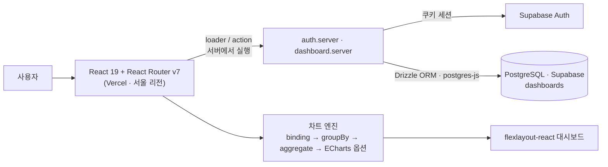
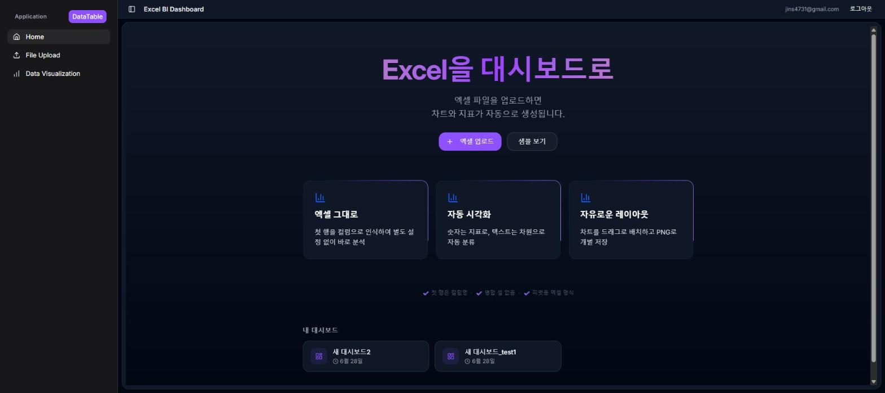
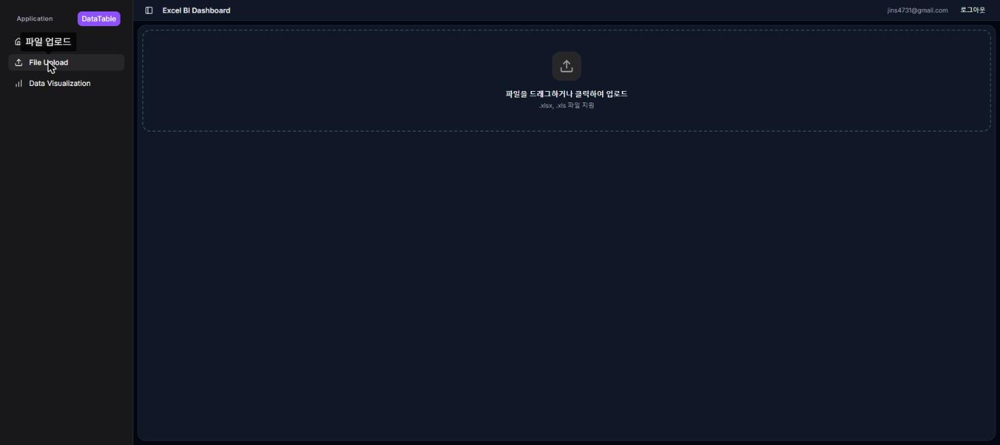
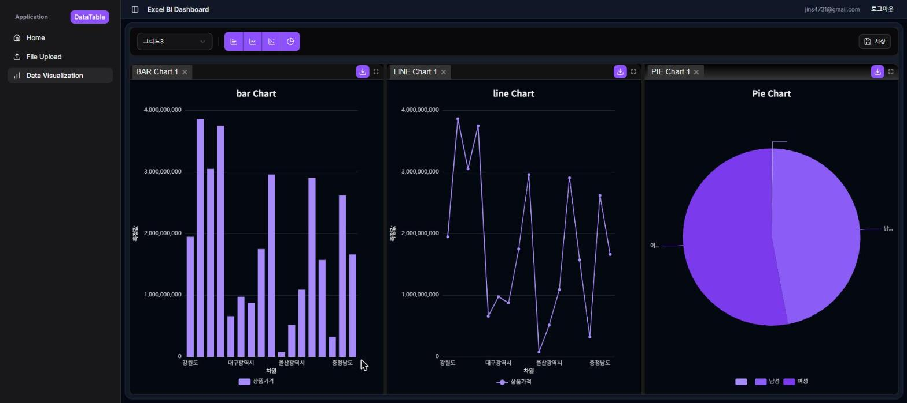
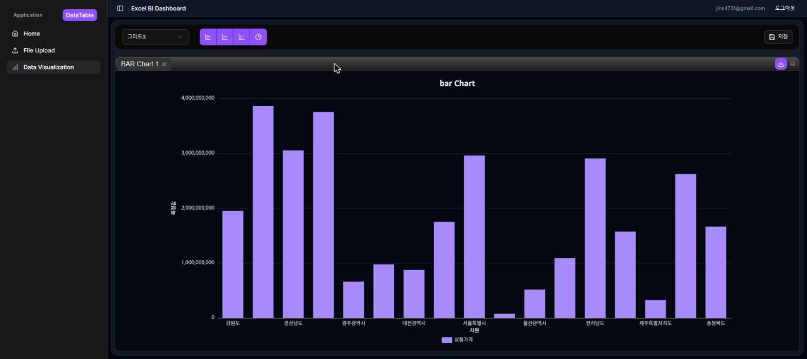

# 🧩 Self-Service BI 데이터 모델링 플랫폼 (DataDesign Dashboard)

> Excel 데이터를 업로드하는 것만으로 데이터 테이블을 만들고, 차트와 대시보드까지 직접 구성·저장할 수 있는 Self-Service BI 웹 서비스

🔗 [Repository](https://github.com/jins4731/datadesign-dashboard) · 🌐 [Demo](https://wemake.bar/)

**기간** 2025.10 ~ 2026.07 · **인원** 1인 (기획 · 설계 · 프론트엔드 · 서버 · 배포)
**기술 스택** React 19, TypeScript, React Router v7(Framework mode), Vite · Supabase Auth, PostgreSQL(Supabase), Drizzle ORM · Apache ECharts, flexlayout-react, xlsx · shadcn/ui, Radix UI, MUI Tree View, Tailwind CSS · Vercel, Docker

> 🧭 메인 포트폴리오로 돌아가기: [portfolio.md](./portfolio.md) · 회사 프로젝트: [career.md](./career.md)

---

## 📌 프로젝트를 시작한 이유

회사에서 진행한 [BI 데이터 설계 플랫폼 개발](./career.md) 프로젝트를 통해, SQL 지식이 없는 사용자에게 데이터 모델링이 얼마나 높은 진입장벽인지 직접 경험했습니다. 그 프로젝트는 조직 내부용 솔루션이라 데이터 소스와 배포 환경이 이미 정해져 있었지만, **"개인이 가진 엑셀 데이터만으로 아무 설치 없이 대시보드까지 만들 수 있다면 어떨까"** 라는 질문에서 이 프로젝트를 시작했습니다.

동시에 회사 제품(JavaScript · CRA · Spring Boot)에서는 써볼 수 없던 **TypeScript, React 19, React Router v7의 서버 loader/action, 서버리스 배포**를 실제 서비스 규모로 다뤄보고 싶었습니다. 기획부터 배포까지 혼자 책임지면서, 회사에서는 이미 정해져 있던 아키텍처 의사결정을 스스로 내려보는 것이 목표였습니다.

---

## 🏗 Architecture

React Router v7의 Framework mode로 화면과 서버 로직을 한 저장소에서 관리합니다. 별도 API 서버 없이 라우트의 `loader`/`action`이 서버에서 실행되며 인증 확인과 DB 조회·저장을 맡습니다.



| 계층 | 구성 |
| --- | --- |
| 라우팅 / 서버 로직 | `app/routes.ts` 설정 기반 라우팅, 보호 라우트의 `loader`·`action`에서 `requireUser()`로 인증 확인 |
| 인증 | `@supabase/ssr`로 쿠키 기반 세션을 서버에서 읽고, 미인증 시 로그인 페이지로 redirect |
| 데이터 저장 | Drizzle ORM + `postgres-js`로 Supabase PostgreSQL에 대시보드 저장·목록·단건 조회 (사용자 ID 조건으로 본인 데이터만 조회) |
| 차트 엔진 | UI와 분리된 순수 TypeScript 모듈(`app/engine`)로 데이터 가공과 ECharts 옵션 생성 |
| 배포 | Vercel(서울 `icn1` 리전), 다른 환경을 위한 멀티 스테이지 Dockerfile |

---

## 🤔 기술 선택 이유

| 영역 | 기술 | 선택 이유 |
| --- | --- | --- |
| 프레임워크 | React 19, React Router v7, Vite | `loader`/`action`으로 데이터 조회·저장을 라우트 단위로 응집시키고, 별도 백엔드 없이 서버 로직을 둘 수 있어 1인 프로젝트 규모에 맞았습니다 |
| 언어 | TypeScript | 차트 설정(`ChartSettings`)·데이터 매핑·ECharts 옵션처럼 중첩이 깊은 설정 객체를 타입으로 고정해, 설정 구조를 바꿀 때 영향 범위를 컴파일러로 확인하기 위해 |
| 인증 | Supabase Auth (`@supabase/ssr`) | 인증 서버를 직접 만드는 대신 BaaS에 맡기고, 서버 렌더링 환경에서 쿠키 세션을 읽는 부분에 집중하기 위해 |
| DB 접근 | Drizzle ORM, postgres-js | 스키마를 TypeScript로 정의해 쿼리 결과까지 타입이 이어지고, 런타임이 가벼워 서버리스(Vercel) 환경에 맞았습니다 |
| 시각화 | Apache ECharts | 회사 업무에서 대용량 데이터 렌더링 성능을 확인한 라이브러리로, 차트 타입과 옵션 커스터마이징 범위가 넓어 선택 |
| 대시보드 레이아웃 | flexlayout-react | 위젯 배치·리사이즈·탭 구성을 직접 구현하는 대신 검증된 레이아웃 엔진을 쓰고, 레이아웃 상태를 JSON으로 저장·복원할 수 있어 선택 |
| UI | shadcn/ui, Radix UI, Tailwind CSS | 접근성이 확보된 헤드리스 컴포넌트를 코드로 가져와 자유롭게 수정하기 위해 |
| 엑셀 처리 | xlsx | 브라우저에서 다중 시트 엑셀 파일을 파싱하기 위해 |

---

## 🔄 데이터 흐름

```
Excel 업로드 (xlsx)
  → 시트 선택, 첫 행을 컬럼으로 해석해 미리보기
  → 사용할 컬럼을 골라 데이터 테이블로 등록 (앱 전역 상태)
  → 차트에 Dimension / Measure 지정
  → 차트 엔진: binding → groupBy → aggregate → ECharts 옵션 생성
  → Dashboard Builder에서 위젯으로 배치 (flexlayout-react)
  → 저장 시 레이아웃 JSON + 차트 설정·데이터 테이블을 JSONB로 저장 (Drizzle → PostgreSQL)
```

저장 단위를 "대시보드 하나"로 잡아, 레이아웃(`layout_json`)과 차트 설정·데이터 테이블(`charts_json`)을 한 행에 JSONB로 저장합니다. 불러오면 저장 시점의 데이터와 레이아웃이 그대로 복원됩니다.

| 홈 | Dataset Builder (엑셀 업로드) | Dashboard Builder |
| --- | --- | --- |
|  |  |  |

---

## ✨ 핵심 기능

### 1. Dataset Builder
- Excel 파일 업로드, 다중 시트 중 선택, 미리보기 테이블에서 컬럼을 골라 데이터 테이블로 등록
- 등록한 데이터 테이블을 트리(MUI Tree View)로 관리하고 삭제

### 2. Chart Builder
- Dimension/Measure를 지정하고 집계 함수를 선택해 막대·라인·파이·스캐터 차트 생성
- 축·제목·색상 편집, 차트별 이미지 다운로드(테마 반영)

### 3. Dashboard Builder
- flexlayout-react 기반으로 여러 차트를 탭·분할 레이아웃으로 배치
- 대시보드 저장·목록·불러오기 (로그인 사용자별)

### 4. 사용자 인증
- Supabase Auth 기반 회원가입·로그인·로그아웃, 보호 라우트

**Dataset Builder (엑셀 업로드)**


**Chart Builder**


**Dashboard Builder**


---

## 🛠 구현 과정

1. **엑셀 업로드와 데이터 테이블** (2025.11 ~ 12): xlsx로 시트를 읽어 미리보기 테이블을 만들고, 헤더의 체크박스·선택 박스로 컬럼을 골라 데이터 테이블로 등록·삭제하도록 구현했습니다.
2. **대시보드 레이아웃과 차트** (2025.12): flexlayout-react로 위젯 배치를 붙이고, 막대 차트부터 시작해 축·제목·색상 설정과 라인·파이·스캐터 차트를 차례로 추가했습니다.
3. **배포** (2026.01): Vercel에 배포하고 도메인을 연결, 차트 개별 다운로드를 추가했습니다.
4. **차트 엔진 분리** (2026.06): 차트 컴포넌트 안에 섞여 있던 데이터 가공을 `app/engine`으로 분리해 `binding → groupBy → aggregate → buildEChartsOptions` 파이프라인으로 정리했습니다.
5. **인증과 저장** (2026.06): Supabase Auth와 Drizzle ORM을 붙여 로그인 사용자별 대시보드 저장·불러오기를 구현했습니다.

---

## 🚧 어려웠던 점

**차트 컴포넌트에 섞여 있던 데이터 가공 로직**
차트 타입을 늘릴수록 컴포넌트마다 그룹핑·집계·옵션 생성 코드가 조금씩 다르게 반복됐습니다. 데이터 가공을 React와 무관한 순수 함수 모듈(`app/engine`)로 떼어내 `binding → groupBy → aggregate → ECharts 옵션 생성` 순서의 파이프라인으로 만들었습니다. 이제 차트 컴포넌트는 엔진 결과를 그리기만 하고, 새 차트 타입은 옵션 생성 함수만 추가하면 됩니다.

**Supabase 커넥션 풀러와 prepared statement**
Supabase의 Transaction 모드 커넥션 풀러는 prepared statement를 지원하지 않아, 기본 설정의 postgres 클라이언트로는 쿼리가 실패했습니다. 클라이언트 생성 시 `prepare: false`로 설정해 서버리스 환경에서 풀러를 그대로 쓰도록 해결했습니다.

**인증 확인 때문에 늘어나는 응답 시간**
보호 라우트마다 Supabase 서버에 사용자 확인을 요청하면서 페이지 이동이 느려졌습니다. 세션 유효성 검증은 root 로더에서 한 번만 하고, 각 보호 라우트는 쿠키의 세션을 로컬에서 읽는 `getSession()`으로 확인하도록 나눠 라우트마다 생기던 인증 네트워크 요청을 없앴습니다. 함수가 해외 리전에서 실행되던 것도 Vercel 리전을 서울(`icn1`)로 지정해 DB·인증 서버와의 거리를 줄였습니다.

**저장 단위 결정**
처음에는 데이터 테이블과 차트를 따로 저장하는 구조를 고민했지만, 개인 사용자가 "만든 대시보드를 그대로 다시 여는 것"이 핵심 시나리오라고 보고 대시보드 단위로 레이아웃과 차트 설정·데이터를 JSONB 한 행에 저장했습니다. 단순한 대신, 같은 데이터를 여러 대시보드가 공유하지는 못한다는 한계가 있습니다.

---

## 🔭 앞으로 계획

- 데이터 테이블을 대시보드와 분리해 별도 테이블로 저장하고 여러 대시보드에서 공유
- 업로드 시 컬럼 타입(숫자·날짜·문자) 자동 추론과 차트 설정 검증(React Hook Form + Zod)
- 차트 엔진 단위 테스트, 히트맵·스택 차트 추가
- AI 기반 차트 추천 (회사 [AI 기반 분석 자동화](./career.md) 경험 적용), 대시보드 공유와 권한 관리

---

📖 함께 보기: [portfolio.md](./portfolio.md) · [career.md](./career.md) · [performance.md](./performance.md)
